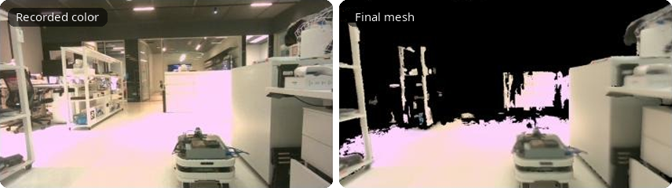

# realsense-to-usd

[繁體中文](README.zh-TW.md)

Hand-held Intel RealSense D455 → live 3D reconstruction → 3D Gaussian Splatting → a USD stage for NVIDIA Isaac Sim.

- **Live** (`python main.py`): ORB-SLAM3 stereo + IMU poses, Fast-FoundationStereo depth (TensorRT) and an nvblox TSDF preview, all at once,
  in a window with the map, the tracked image, depth and status. On Stop, a distance-weighted TSDF mesh is built from every stored frame.
- **Offline** (`python -m gs.offline`): the session's frames (people masked out, live or here) → TSDF mesh → FastGS 3DGS → `scene.usdc`
  (Z-up, meters, leveled; Gaussians for display, the decimated mesh as a static collider).

## Tested environment

| Component | Version |
|---|---|
| Hardware | NVIDIA Jetson AGX Thor Developer Kit |
| OS | Ubuntu 24.04.5 LTS (kernel 6.8.12-tegra) |
| JetPack | 7.1 (L4T R38.4.0) |
| CUDA | 13.0 |
| Camera | Intel RealSense D455, firmware 5.17.3.10 |
| Python | 3.12 (conda), PyTorch 2.9.1+cu130, TensorRT 11.3, Open3D 0.20.0, pyrealsense2 2.58.4 |

Isaac Sim needs RTX ray-tracing hardware to render the result, so open the USD on an x86_64 + RTX machine.

## Example: a 3-minute loop around a lab

Hand-held D455 (848x480, projector alternating), 187 s, 19.4 m of camera path, Jetson AGX Thor.

| Step | Result | Time |
|---|---|---|
| Tracking (ORB-SLAM3 stereo + IMU) | 4811 / 4829 IR pairs tracked; 35 ms each (p90 43) | live |
| Depth (FFS, TensorRT fp32 + TF32) | 934 frames, 5.0 Hz; 188 ms each | live |
| Capture → in the preview map | 263 ms (p90 460) | live |
| Stop → final mesh (4 m, distance-weighted TSDF) | 3.3 M triangles | 31 s |
| 3DGS -> USD: TSDF + COLMAP export + FastGS + USD | 364 k Gaussians; `scene.usdc` 169 MB | ~11 min |




## Pipeline

```
D455 ──► tracker process: projector-off IR pair ──► ORB-SLAM3 stereo (+ IMU), 30 Hz
     │                                                     │ poses (loop closures → map rebuilt with the corrected trajectory)
     └─► depth thread: newest projector-on IR pair ──► FFS (TensorRT) ──► depth in the color camera
                                     people masked out (DeepLabV3, TensorRT) ──┤
                                     mapper: nvblox TSDF preview (depth ≤ 2.5 m) ──► window
Stop ──► final trajectory ──► distance-weighted TSDF of every stored frame (depth ≤ 4 m) ──► mesh_live.ply
     └─► frames/ (color + FFS depth + person masks + poses), rec/ (every frameset: color, IR, IMU)

3DGS -> USD (window) or gs/offline.py: frames/ ──► (person masks, if not made live) ──► TSDF + point cloud (no people)
    ──► COLMAP text + masks ──► FastGS (no loss on people) ──► scene.usdc
```

## Installation

See [docs/install](docs/install/README.md): the conda env, nvblox, ORB-SLAM3 and its Python binding, Fast-FoundationStereo + TensorRT,
person segmentation, FastGS. Speed and accuracy before and after TensorRT: [docs/tensorrt](docs/tensorrt/README.md);
faster FFS settings: [docs/ffs_speed](docs/ffs_speed/README.md); every node timed and the speed-ups:
[docs/profile](docs/profile/README.md); ORB-SLAM3 vs OpenVINS (+ RTAB-Map), VINS-Fusion and
cuVSLAM on the recordings: [docs/vslam](docs/vslam/README.md).

## Usage

```bash
conda activate realsense-to-usd
python main.py -o output/live_room       # Stop in the window or Ctrl+C to end
python -m gs.offline output/live_room  # -> scene.usdc, or 3DGS -> USD in the window
```

Hold the camera still for a second at the start (leveling with the IMU), then move it. Keep the D455 on USB 3.

## References

- [ORB-SLAM3](https://github.com/UZ-SLAMLab/ORB_SLAM3)
- [Fast-FoundationStereo](https://github.com/NVlabs/Fast-FoundationStereo)
- [nvblox](https://github.com/nvidia-isaac/nvblox)
- [FastGS](https://github.com/fastgs/FastGS)

## Licenses

GPL-3.0. Since the pipeline includes Inria 3DGS and NVIDIA Fast-FoundationStereo, it is for **non-commercial research only**.
