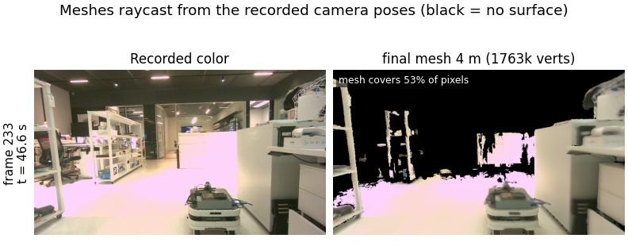
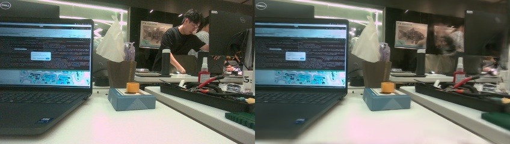

# realsense-to-usd

[繁體中文](README.zh-TW.md)

Hand-held Intel RealSense D455 → live 3D reconstruction → 3D Gaussian Splatting → a USD stage for NVIDIA Isaac Sim.

- **Live** (`run_live.sh`): ORB-SLAM3 stereo + IMU poses, Fast-FoundationStereo depth (TensorRT) and an nvblox TSDF preview, all at once,
  in a window with the map, the tracked image, depth and status. On Stop, a distance-weighted TSDF mesh is built from every stored frame.
- **Offline** (`run_offline.sh`): the session's frames → TSDF mesh → FastGS 3DGS → `scene.usdc`
  (Z-up, meters, leveled; Gaussians for display, the decimated mesh as a static collider).

Developed and tested on a Jetson AGX Thor (JetPack 7.1, CUDA 13).
Isaac Sim needs RTX ray-tracing hardware to render the result, so open the USD on an x86_64 + RTX machine.

## Example: a 3-minute loop around a lab

Hand-held D455 (848x480, projector alternating), 187 s, 19.4 m of camera path, Jetson AGX Thor.

| Step | Result | Time |
|---|---|---|
| Tracking (ORB-SLAM3 stereo + IMU) | 4811 / 4829 IR pairs tracked; 35 ms each (p90 43) | live |
| Depth (FFS, TensorRT fp32 + TF32) | 934 frames, 5.0 Hz; 188 ms each | live |
| Capture → in the preview map | 263 ms (p90 460) | live |
| Stop → final mesh (4 m, distance-weighted TSDF) | 3.3 M triangles | 31 s |
| `run_offline.sh`: TSDF + COLMAP export + FastGS (31k steps) + USD | test views PSNR 25.45, SSIM 0.838, LPIPS 0.272; 364 k Gaussians; `scene.usdc` 169 MB | ~11 min |



*`mesh_live.ply` rendered from the recorded poses. Far glass and background have no surface (black).*



*Left: captured, right: 3DGS. Screens whose content changed and people walking by are blurred.*

## Pipeline

```
D455 ──► tracker process: projector-off IR pair ──► ORB-SLAM3 stereo (+ IMU), 30 Hz
     │                                                     │ poses (loop closures → map rebuilt with the corrected trajectory)
     └─► depth thread: newest projector-on IR pair ──► FFS (TensorRT) ──► depth in the color camera
                                                           │
                                     mapper: nvblox TSDF preview (depth ≤ 2.5 m) ──► window
Stop ──► final trajectory ──► distance-weighted TSDF of every stored frame (depth ≤ 4 m) ──► mesh_live.ply
     └─► frames/ (color + FFS depth + poses), rec/ (every frameset: color, D455 depth, IR, IMU)

run_offline.sh: frames/ ──► TSDF + point cloud ──► COLMAP text ──► FastGS ──► scene.usdc
```

## Installation

See [INSTALL.md](INSTALL.md): the conda env, nvblox, ORB-SLAM3 and its Python binding, Fast-FoundationStereo + TensorRT, FastGS.

## Usage

```bash
sudo jetson_clocks   # Jetson: max clocks (otherwise the GPU idles down between FFS calls)
./run_live.sh                        # until Stop in the window or Ctrl+C -> output/live_<date>_<time>/
./run_live.sh --duration 120 -o output/live_room
./run_live.sh --no-imu --no-record   # cameras only, without the full recording
./run_offline.sh output/live_room    # -> output/live_room/scene.usdc
```

With `--imu` (the `run_live.sh` default) hold the camera still for a second at the start (leveling), then move it:
tracking starts once the IMU sees some motion. Keep the D455 on USB 3; `rec/` takes ~40 MB/s (2.4 GB a minute).

The window shows the nvblox map with the trajectory and current camera (Free / Follow / Camera views), the tracked IR image
with its ORB features, the FFS depth over color, and tracking / depth / map status. Buttons: **Stop** (end and save; then
**New recording** starts the next session in `<out>_2`, ...), **Discard & restart**, **Re-level (IMU)**.
Without a display (`--no-view`) the numbers go to `live.json`. `DISPLAY` defaults to `:1` in `run_live.sh`.

A recorded session can be replayed through the same live pipeline: `python recon/live.py output/live_room/rec -o output/replay --imu`.

### Session output

```
output/live_<date>_<time>/
  mesh_live.ply     final mesh (world: Z up from the accelerometer, origin at the first camera)
  poses_live.npy    Nx4x4 color camera-to-world of the frames in frames/
  live.json         timings: tracking, depth, integration, latency, rebuilds
  frames/           fused frames: color/, depth_ffs/ (uint16 mm), meta.json, poses.npy   <- run_offline.sh input
  rec/              every frameset: color/, depth/ (D455, aligned to color), ir1_on/ ir2_on/ (projector on),
                    ir1/ ir2/ (projector off), imu.csv, meta.json, poses.npy
  recon/ colmap/ fastgs/ scene.usdc     after run_offline.sh
```

A *frames dir* (`frames/` or `rec/`) is what every offline script takes: numbered PNGs per stream and `meta.json`
(color intrinsics, per-frame timestamps, and for IR the stereo intrinsics, baseline, `ir1_from_color` and the projector mode).
Offline tools for `rec/`: `recon/stereo_depth.py` (FFS depth at 30 Hz instead of live's ~5 Hz), `recon/track_orbslam3.py`.

### USD stage

```
/World                default prim
    DomeLight
    Scene             leveled (largest horizontal plane of the mesh)
        Mesh          full mesh with vertex colors, hidden (--show-mesh to show)
        Collision     decimated to 300k triangles, hidden, static collider (UsdPhysics)
        Gaussians     UsdVol.ParticleField3DGaussianSplat, SH degree 3
/PhysicsScene         gravity -Z (outside the default prim, so referencing the asset does not bring it along)
```

`ParticleField3DGaussianSplat` is the OpenUSD 26.03 3DGS schema; Isaac Sim 6.0 renders it. Tools without it (e.g. `usdview`)
show nothing unless `--show-mesh`.

## Licenses

This repository is GPL-3.0 (the live tracker links ORB-SLAM3, which is GPL-3.0). Third-party components keep their own terms:
ORB-SLAM3 GPL-3.0; nvblox Apache-2.0; Fast-FoundationStereo code under NVIDIA's own source license (see its LICENSE.txt), the C-FFS
weights under the NVIDIA Open Model Agreement; FastGS MIT, but its Inria 3DGS code is for non-commercial research only.
