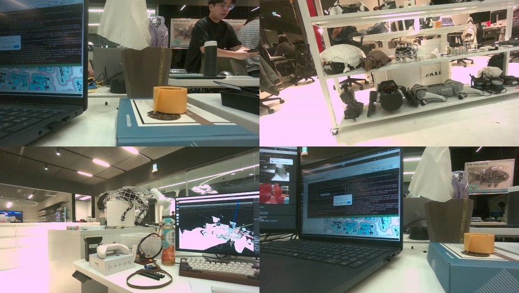

# realsense-to-usd

[English](README.md)

手持 Intel RealSense D455 → 即時 3D 重建 → 3D Gaussian Splatting → 給 NVIDIA Isaac Sim 的 USD。

- **即時**（`run_live.sh`）：ORB-SLAM3 雙目 + IMU 位姿、Fast-FoundationStereo 深度（TensorRT）、nvblox TSDF 預覽同時跑，
  視窗顯示地圖、追蹤中的影像、深度與狀態。按 Stop 後用存下的所有幀建距離加權的 TSDF mesh。
- **離線**（`run_offline.sh`）：這段錄影的幀 → TSDF mesh → FastGS 3DGS → `scene.usdc`
  （Z-up、公尺、已水平；高斯負責顯示，減面後的 mesh 當靜態碰撞體）。

在 Jetson AGX Thor（JetPack 7.1、CUDA 13）上開發與測試，x86_64 + NVIDIA RTX GPU 也能跑。
Isaac Sim 算圖需要 RTX 的 ray tracing 硬體，USD 要在 x86_64 + RTX 的電腦上開。



## 範例：實驗室繞一圈 3 分鐘

手持 D455（848x480，投射器交替），187 秒，相機移動 19.4 m，Jetson AGX Thor。

| 步驟 | 結果 | 時間 |
|---|---|---|
| 追蹤（ORB-SLAM3 雙目 + IMU） | 4811 / 4829 組 IR；每組 35 ms（p90 43） | 即時 |
| 深度（FFS，TensorRT fp32 + TF32） | 934 幀，5.0 Hz；每幀 188 ms | 即時 |
| 拍到 → 進預覽地圖 | 263 ms（p90 460） | 即時 |
| Stop → 最終 mesh（4 m、距離加權 TSDF） | 331 萬個三角形 | 31 秒 |
| `run_offline.sh`：TSDF + 匯出 COLMAP + FastGS（31k 步）+ USD | 測試視角 PSNR 25.45、SSIM 0.838、LPIPS 0.272；36.4 萬個高斯；`scene.usdc` 169 MB | 約 11 分鐘 |


*`mesh_live.ply` 從錄影的位姿渲染。遠處的玻璃與背景沒有表面（黑色）。*


*左：實拍，右：3DGS。錄影時內容在變的螢幕和走動的人模糊。*

## 流程

```
D455 ──► 追蹤 process：投射器關的 IR ──► ORB-SLAM3 雙目（+ IMU），30 Hz
     │                                       │ 位姿（迴環 → 用修正後的軌跡重建地圖）
     └─► 深度 thread：最新一組投射器開的 IR ──► FFS（TensorRT）──► 對齊到 color 的深度
                                             │
                     地圖：nvblox TSDF 預覽（深度 ≤ 2.5 m）──► 視窗
Stop ──► 最終軌跡 ──► 存下的所有幀做距離加權 TSDF（深度 ≤ 4 m）──► mesh_live.ply
     └─► frames/（color + FFS 深度 + 位姿）、rec/（每組 frameset：color、D455 深度、IR、IMU）

run_offline.sh：frames/ ──► TSDF + 點雲 ──► COLMAP text ──► FastGS ──► scene.usdc
```

| 路徑 | 內容 |
|---|---|
| `run_live.sh` | D455 即時錄影（預設 `--projector alternate --imu`，其餘參數傳給 `recon/live.py`） |
| `run_offline.sh` | 一段錄影 → `recon/`、`colmap/`、`fastgs/`、`scene.usdc` |
| `recon/live.py` | 即時重建（D455，或重播錄下的 `rec/`） |
| `recon/live_workers.py` | D455 擷取、IR 曝光控制、IMU、存檔、ORB-SLAM3 追蹤 process |
| `recon/live_view.py` | 視窗（Open3D GUI） |
| `recon/orbslam3_py/` | 追蹤用的 ORB-SLAM3 pybind11 binding |
| `recon/ffs.py`、`recon/export_ffs_trt.py` | Fast-FoundationStereo 推論 / 匯出 TensorRT 引擎 |
| `recon/stereo_depth.py` | 離線 FFS 深度；視差 → color 相機深度的轉換即時版也用 |
| `recon/reconstruct.py` | Open3D TSDF，以及最終 mesh 用的距離加權 TSDF（Triton） |
| `recon/reconstruct_nvblox.py` | nvblox TSDF（即時預覽，也可離線） |
| `recon/track_orbslam3.py` | 錄下的 `rec/` 離線跑 ORB-SLAM3 位姿 |
| `gs/export_colmap.py`、`gs/train_fastgs.sh` | 用已知位姿匯出 COLMAP 格式、FastGS 訓練與評分 |
| `gs/export_usd.py` | mesh + 3DGS → USD |
| `patches/` | nvblox、ORB-SLAM3、FastGS 的修正（見下方） |
| `frames.py` | 幀資料夾讀寫、深度濾波、位姿工具 |

## 安裝

全部在同一個 conda 環境裡跑（預設名稱 `realsense-to-usd`，用別的名稱時設 `RS2USD_ENV`）。
`source env.sh` 會啟用環境、把 `CUDA_HOME` 指到環境裡 pip 安裝的 CUDA 13 toolkit，並把 repo 根目錄加進 `PYTHONPATH`。
所有指令都在 repo 根目錄執行。

```bash
conda create -n realsense-to-usd python=3.12 "numpy>=2" imageio matplotlib pip
source env.sh
pip install torch==2.9.1+cu130 torchvision --index-url https://download.pytorch.org/whl/cu130/
pip install "nvidia-cuda-nvcc==13.0.*" "nvidia-cuda-cccl==13.0.*" "nvidia-cuda-crt==13.0.*" \
    "nvidia-nvvm==13.0.*" "nvidia-npp==13.*" ninja open3d==0.20.0 pyrealsense2 opencv-python-headless \
    scipy plyfile pybind11
C=$CUDA_HOME && ln -sf lib $C/lib64 && ln -sf libcudart.so.13 $C/lib/libcudart.so
conda install -c conda-forge openusd=26.03   # 匯出 USD（PyPI 的 usd-core 沒有 aarch64 版）
```

`nvidia-nvvm` 一定要固定在 13.0，新版產生的 PTX ptxas 不支援（`Unsupported .version`）。

### nvblox

套用 `patches/nvblox-thor.patch` 後從原始碼編譯（`live.py` 用到 patch 改過的 `add_color_frame`，官方 wheel 不能用）。
x86_64 上把 `CMAKE_CUDA_ARCHITECTURES` 改成自己的 GPU（例如 `89`），`CMAKE_CUDA_COMPILER` 指到 CUDA 13 的 `nvcc`。

```bash
git clone --branch v0.0.10 https://github.com/nvidia-isaac/nvblox.git ~/nvblox
git -C ~/nvblox apply $PWD/patches/nvblox-thor.patch
cmake -S ~/nvblox -B ~/nvblox/build -DCMAKE_BUILD_TYPE=Release -DBUILD_RENDERER=0 -DBUILD_TESTING=0 \
    -DCMAKE_CUDA_ARCHITECTURES=110 -DCMAKE_CUDA_COMPILER=/usr/local/cuda/bin/nvcc \
    -DTorch_DIR=$(python -c "import torch,os; print(os.path.dirname(torch.__file__))")/share/cmake/Torch \
    -DPython3_EXECUTABLE=$(which python)
cmake --build ~/nvblox/build -j12
(cd ~/nvblox/nvblox_torch && CUDA_VERSION=13.0 pip install --no-build-isolation --editable .)
```

`BUILD_RENDERER=0`：renderer 需要 Vulkan SDK，重建用不到。patch 內容：sm_110 的 CUDA 架構轉換、`numpy>=2` / `opencv-python-headless`
取代原本鎖定的版本、`NVBLOX_FREE_SPACE_VOX`（限制 free space 清除的距離）、`add_color_frame(..., depth_frame)`（用對齊的深度融合顏色）、
`NVBLOX_STREAM_PRIORITY`（`live.py` 讓融合在 GPU 上排在 FFS 前面）。

### ORB-SLAM3 與 Python binding

```bash
git clone -b v0.9.3 https://github.com/stevenlovegrove/Pangolin.git ~/Pangolin
cmake -S ~/Pangolin -B ~/Pangolin/build -DCMAKE_BUILD_TYPE=Release -DBUILD_EXAMPLES=OFF -DBUILD_TOOLS=OFF \
    -DBUILD_PANGOLIN_PYTHON=OFF -DBUILD_TESTS=OFF -DCMAKE_INSTALL_PREFIX=$HOME/.local/pangolin
cmake --build ~/Pangolin/build -j12 && cmake --install ~/Pangolin/build
git clone https://github.com/UZ-SLAMLab/ORB_SLAM3.git ~/ORB_SLAM3 && git -C ~/ORB_SLAM3 checkout 4452a3c
git -C ~/ORB_SLAM3 apply $PWD/patches/orbslam3-thor.patch
(cd ~/ORB_SLAM3 && for d in Thirdparty/DBoW2 Thirdparty/g2o; do
     cmake -S $d -B $d/build -DCMAKE_BUILD_TYPE=Release -DCMAKE_CXX_STANDARD=17 && cmake --build $d/build -j12; done
 tar -xf Vocabulary/ORBvoc.txt.tar.gz -C Vocabulary
 cmake -B build -DCMAKE_BUILD_TYPE=Release -DPangolin_DIR=$HOME/.local/pangolin/lib/cmake/Pangolin
 cmake --build build -j8 --target ORB_SLAM3 stereo_euroc)

cmake -S recon/orbslam3_py -B recon/orbslam3_py/build -DPython3_EXECUTABLE=$(which python) \
    -Dpybind11_DIR=$(python -c "import pybind11; print(pybind11.get_cmake_dir())")
cmake --build recon/orbslam3_py/build -j8   # -> recon/orbslam3_py/orbslam3_py.cpython-312-*.so
```

patch 內容：C++17（Pangolin 0.9 需要）、`mnFullBAIdx` 改成 `int`、Rectified 雙目印設定時不再 segfault、`stereo_euroc` 不開視窗、
給 binding 用的 `GetTracker()` / `GetAtlas()`、雙目 + IMU 遇到沒有預積分的幀時跳過 IMU 預測（原本解參考空指標）、
「Not enough motion」的地圖重置只用在單眼。ORB-SLAM3 不在 `~/ORB_SLAM3` 時用 `--orb-root` 與 CMake 變數 `ORB_SLAM3_ROOT` 指定。

### Fast-FoundationStereo + TensorRT

```bash
git clone https://github.com/NVlabs/Fast-FoundationStereo.git ~/Fast-FoundationStereo
python -c "from huggingface_hub import snapshot_download; snapshot_download('nvidia/c-fast-foundationstereo', local_dir='$HOME/Fast-FoundationStereo/weights/c-ffs')"
pip install scikit-image omegaconf "tensorrt-cu13==11.3.0.99"
python recon/export_ffs_trt.py -o output/ffs --width 864   # live.py 要的 848x480 引擎（約 5 分鐘）
```

TensorRT 用 pip 裝進環境，不動系統的 TensorRT。引擎綁定輸入大小與 TensorRT 版本。

### FastGS

```bash
git clone https://github.com/fastgs/FastGS.git ~/FastGS
git -C ~/FastGS apply $PWD/patches/fastgs-thor.patch
pip install websockets lpips
pip install --no-build-isolation ~/FastGS/submodules/simple-knn ~/FastGS/submodules/fused-ssim \
    ~/FastGS/submodules/diff-gaussian-rasterization_fastgs
```

不在 `~/FastGS` 時設 `FASTGS_ROOT`。patch 內容：CUDA 13 編譯、光柵化的 tile 清單越界寫入（訓練中途 `cudaErrorIllegalAddress`）、
投影矩陣支援偏離中心的主點（D455 color 的主點偏好幾個 px，不修正時高斯和 TSDF mesh 差約 9 mm）。

## 使用

```bash
sudo jetson_clocks   # Jetson：鎖最高時脈（否則 GPU 在兩次 FFS 之間降頻）
./run_live.sh                        # 按視窗的 Stop 或 Ctrl+C 結束 -> output/live_<日期>_<時間>/
./run_live.sh --duration 120 -o output/live_room
./run_live.sh --no-imu --no-record   # 只用影像、不完整存檔
./run_offline.sh output/live_room    # -> output/live_room/scene.usdc
```

`--imu`（`run_live.sh` 的預設）時，開始先拿穩相機 1 秒（轉正），再移動一下，IMU 看到動作才開始追蹤。
D455 要接 USB 3；`rec/` 約 40 MB/s（每分鐘 2.4 GB）。

視窗顯示 nvblox 地圖、軌跡與目前相機（Free / Follow / Camera 視角）、追蹤中的 IR 影像與 ORB 特徵點、疊在 color 上的 FFS 深度、
以及追蹤 / 深度 / 地圖狀態。按鈕：**Stop**（結束並存檔；之後 **New recording** 開始下一段，輸出到 `<out>_2`…）、
**Discard & restart**、**Re-level (IMU)**。沒有螢幕時用 `--no-view`，數字寫在 `live.json`。`run_live.sh` 的 `DISPLAY` 預設 `:1`。

錄下的一段可以用同一套即時流程重播：`python recon/live.py output/live_room/rec -o output/replay --imu`。

### 輸出

```
output/live_<日期>_<時間>/
  mesh_live.ply     最終 mesh（世界座標：加速度計定的 Z 朝上，原點在第一幀相機）
  poses_live.npy    frames/ 每一幀的 Nx4x4 color 相機到世界
  live.json         時間：追蹤、深度、融合、延遲、重建
  frames/           融合過的幀：color/、depth_ffs/（uint16 mm）、meta.json、poses.npy   <- run_offline.sh 的輸入
  rec/              每組 frameset：color/、depth/（D455，對齊到 color）、ir1_on/ ir2_on/（投射器開）、
                    ir1/ ir2/（投射器關）、imu.csv、meta.json、poses.npy
  recon/ colmap/ fastgs/ scene.usdc     run_offline.sh 之後
```

離線腳本的輸入都是「幀資料夾」（`frames/` 或 `rec/`）：每個 stream 一個資料夾的編號 PNG，加上 `meta.json`
（color 內參、每幀時間戳；IR 的雙目內參、基線、`ir1_from_color` 與投射器模式）。
`rec/` 可用的離線工具：`recon/stereo_depth.py`（30 Hz 的 FFS 深度，即時版約 5 Hz）、`recon/track_orbslam3.py`。

### USD

```
/World                預設 prim
    DomeLight
    Scene             水平化（mesh 最大的水平面）
        Mesh          完整 mesh、頂點色，隱藏（--show-mesh 顯示）
        Collision     減面到 30 萬個三角形，隱藏，靜態碰撞體（UsdPhysics）
        Gaussians     UsdVol.ParticleField3DGaussianSplat，3 階 SH
/PhysicsScene         重力 -Z（放在預設 prim 外，以 reference 載入時不會帶進來）
```

`ParticleField3DGaussianSplat` 是 OpenUSD 26.03 的 3DGS schema，Isaac Sim 6.0 看得到；不支援的工具（例如 `usdview`）
要加 `--show-mesh` 才有畫面。

## 授權

本 repo 為 GPL-3.0（即時追蹤透過 binding 連結 GPL-3.0 的 ORB-SLAM3）。第三方元件各有授權：
ORB-SLAM3 GPL-3.0；nvblox Apache-2.0；Fast-FoundationStereo 程式碼為 NVIDIA 自己的授權（見其 LICENSE.txt），C-FFS 權重為
NVIDIA Open Model Agreement；FastGS 為 MIT，但其中沿用的 Inria 3DGS 程式碼只能做非商業研究。
