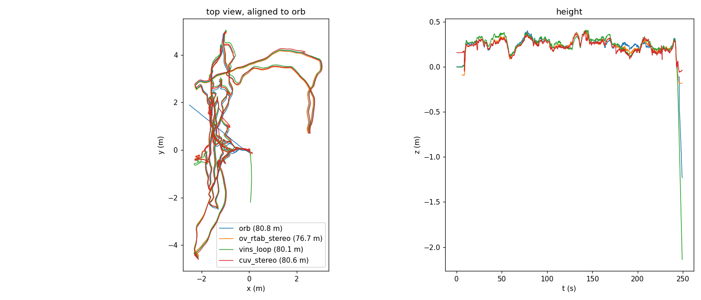

# Visual SLAM on the D455: ORB-SLAM3 vs OpenVINS (+ RTAB-Map), VINS-Fusion, cuVSLAM

[繁體中文](README.zh-TW.md)

main.py tracks with ORB-SLAM3 (stereo + IMU). Four other widely used visual(-inertial) SLAM systems on the same input,
**stability first, accuracy second**: the projector-off IR pair (848x480, ~28 Hz) and the IMU (200 Hz) of 5 recordings,
replayed offline on the Jetson AGX Thor. There is no ground truth: stability is judged against the session's own IMU,
accuracy against ORB-SLAM3 and by how well depth lines up where the camera comes back to a place.

| | Type | Loop closure | Runs as |
|---|---|---|---|
| ORB-SLAM3 | feature-based SLAM, stereo + IMU | yes (place recognition, global BA, map merging) | main.py, live (its saved `frames/poses.npy`) |
| OpenVINS | MSCKF filter VIO, stereo + IMU | no | ROS 2 Jazzy in docker, real time |
| OpenVINS + RTAB-Map | RTAB-Map's graph on OpenVINS' odometry, with the IR pair (`stereo`) or color + FFS depth (`rgbd`) for loop closures | yes | ROS 2 Jazzy in docker, real time |
| VINS-Fusion | optimization VIO, stereo + IMU; `vins_loop`: with loop_fusion (4-DoF pose graph) | yes | ROS 1 Noetic in docker, real time |
| cuVSLAM 17 | GPU VIO + SLAM; `cuv_vio` stereo + IMU, `cuv_stereo` stereo only | yes | Python (pip `cuvslam`), as fast as it goes |

Reproduce (the recordings in `output/live_*`, results in `output/vslam/`):

```bash
docker build -t ov-rtabmap:jazzy docs/vslam && docker build -t vins:noetic docs/vslam/vins
docs/vslam/run_all.sh               # OpenVINS, + RTAB-Map stereo / rgbd
docs/vslam/run_all_cuvslam_vins.sh  # cuVSLAM (conda env realsense-to-usd), VINS-Fusion
docs/vslam/score_all.sh             # stability, vs ORB-SLAM3, revisits (ICP), RTAB-Map stats; NO_ICP=1 skips ICP
python docs/vslam/summary.py output output/vslam
```

## Results

5 recordings: four of 29–41 s (2–7 m, the camera held still on a table at the start, ~9–14 s), one of 249 s (80 m,
the same aisle walked back and forth several times).

| | Poses for | First pose | Jumps (largest) | Held still: median / max | vs ORB-SLAM3, 4 short | vs ORB-SLAM3, 249 s¹ |
|---|---:|---:|---:|---:|---:|---:|
| ORB-SLAM3 | 98% | 0.0 s | 2 (0.46 m) | 0.03 / **124** cm/s | – | – |
| OpenVINS | 75% | 9.3 s | **0** | 0.08 / 1.0 cm/s | 0.6–3.6 cm | 7.9 cm |
| OpenVINS + RTAB-Map stereo | 75% | 9.3 s | **0** | 0.08 / 1.0 cm/s | 0.6–2.3 cm | **5.3 cm** |
| OpenVINS + RTAB-Map rgbd | 75% | 9.3 s | **0** | 0.09 / 1.0 cm/s | 1.1–4.6 cm | **5.3 cm** |
| VINS-Fusion | 98% | 0.8 s | **0** | 0.04 / **68** cm/s | 0.6–3.8 cm | 14.0 cm |
| VINS-Fusion + loop_fusion | 98% | 0.8 s | **0** | 0.04 / **68** cm/s | 0.4–5.6 cm | 9.5 cm |
| cuVSLAM stereo + IMU | 100% | 0.0 s | **2695** (diverged) | 0.37 / 764 cm/s | 16–227 cm | diverged (6600 km) |
| cuVSLAM stereo | 100% | 0.0 s | 44 (0.50 m) | 0.22 / 5.7 cm/s | 3.5–39 cm | 9.2 cm |

¹ Up to 15 s before the end: in its last seconds ORB-SLAM3 itself goes wrong (below).

- **Poses for**: share of the recording with a pose. OpenVINS starts only when the camera first moves (its static
  initialization), so the still start of each short recording (9–14 s) has none.
- **Jumps**: steps faster than a hand moves a camera (> 2 m/s or > 6 rad/s between poses at most 0.25 s apart).
- **Held still**: how fast the pose moves while the IMU says the camera is still (1 s windows, |gyro| < 0.03 rad/s,
  accelerometer spread < 0.05 m/s²): 0 in reality. Median over the windows / the worst window.
- **vs ORB-SLAM3**: RMSE of the positions after a rigid alignment (no scale), at the frames of `frames/` (~5 Hz). It is
  the difference to ORB-SLAM3, not an error: on the short recordings ORB-SLAM3 is very likely the more accurate one.
- **Revisits** (ICP on FFS depth where the camera comes back to a place, `eval_revisits.py`): not run yet for
  these settings.



### What went wrong where

- **cuVSLAM stereo + IMU** never worked on these recordings: it diverges as the camera first moves after the still start
  (70 cm off on a 4 m path, 6600 km on the long one). The IMU data are right (gyroscope axes and timing match the visual
  rotation: ×1.0 per axis, 4 ms; the accelerometer reads +g up; ORB-SLAM3, OpenVINS and VINS-Fusion use the same data
  and extrinsics). Not solved. **cuVSLAM stereo only** tracks, but jumps (44 in total, up to 0.5 m), most when the
  camera is lifted from or put down on the table.
- **ORB-SLAM3 and VINS-Fusion at the end of the 249 s recording**: the camera is held still close to a box for the last
  ~3 s, and the projector-off IR images show projector dots (5% of the pixels, 0.5% earlier). Both move 0.6–1.2 m/s
  and ORB-SLAM3 jumps 3 m sideways; OpenVINS (with zero-velocity updates) and cuVSLAM stereo stay put. The dots are a
  likely cause, not a proven one.
- **OpenVINS** needed two settings to be stable: no online camera-IMU calibration (with it, the first update turned
  both cameras' extrinsics by 8° and the time offset to 43 ms, and the filter diverged to 22 km) and zero-velocity
  updates (without them it sank 35 cm in 5 s on the table: 14.4 → 3.6 cm vs ORB-SLAM3 on the 41 s recording).
- **RTAB-Map** (on OpenVINS) found 101 (stereo) / 105 (rgbd) loop closures and ~125 proximity links on the 249 s
  recording, which bring OpenVINS from 7.9 to 5.3 cm of ORB-SLAM3. On the short ones it found few.

### Cost

| | Per frame | Notes |
|---|---:|---|
| ORB-SLAM3 | 35 ms (p90 42) | live, main.py; 760 of 6378 IR pairs skipped on the 249 s one (busy) |
| OpenVINS | 14 ms (p90 19) | Thor CPU |
| RTAB-Map | 110–200 ms per node | 2 nodes per second, CPU |
| VINS-Fusion | – | real time; it tracks every other IR pair (its multi-thread mode) |
| cuVSLAM stereo | 0.5–0.7 ms (p90 0.8–1.5) | GPU |
| cuVSLAM stereo + IMU | 1.1–1.9 ms (p90 9–49) | GPU |

The CPU governor was switched to `performance` (all cores at 2.6 GHz) during these runs, so CPU times are approximate.

## Conclusions

- **Most stable**: OpenVINS (+ RTAB-Map): no jumps, at most 1 cm/s while held still, also where ORB-SLAM3 and
  VINS-Fusion fail at the end of the long recording. Its weak spot is the start: no pose until the camera moves.
- **VINS-Fusion** is as smooth while moving (no jumps) and has a pose from 0.8 s on, but drifts like ORB-SLAM3 at the
  end of the long recording; its loop closures help on the long one (14.0 → 9.5 cm of ORB-SLAM3).
- **ORB-SLAM3** is accurate, but jumps once tracking gets hard.
- **cuVSLAM** is by far the fastest but the least stable on this data (the IR at ~28 Hz with alternating projector).
- For main.py: keep ORB-SLAM3, or switch to OpenVINS + RTAB-Map for stability. The start could take the first pose
  (the camera is still then) and a jump detector (> 2 m/s with a still IMU) could switch from ORB-SLAM3 to a VIO.
